# System Architecture

Owner: Batuhan (architecture & infrastructure). Diagram sources are in [`diagrams/`](diagrams/)
as Mermaid files (`*.mmd`); the SVG/PNG files next to them are rendered from those sources.

**Presentation versions (12 Nov):** simplified 16:9 diagrams in the style of the course slides are in
[`diagrams/presentation/`](diagrams/presentation/): [architecture](diagrams/presentation/architecture.png),
[class diagram](diagrams/presentation/class-diagram.png) and [tooling & workflow](diagrams/presentation/tooling.png).
Regenerate them with `node docs/diagrams/presentation/generate.js`. The detailed diagrams below remain the reference.

## 1. Architecture diagram



Solid boxes and lines exist in the code today. Dashed boxes and lines are planned for later sprints.

### Request flow

1. A user (student, instructor, department head or admin) opens the site in a web browser.
2. The request reaches Django over HTTPS. Middleware handles the session, CSRF protection,
   authentication, and role checks from `accounts.permissions`.
3. URL routing sends the request to one of the five Django apps:

| App | Responsibility |
|---|---|
| `accounts` | Custom `User` model with four roles, login, password reset, audit log |
| `courses` | Course offerings, assessments (with weight %), enrollments |
| `outcomes` | Program Outcomes, Learning Outcomes, Assessment→LO and LO→PO weight tables |
| `grades` | Grades and the score engine (`grades/scoring.py`) |
| `dashboard` | Role-based pages and PO charts |

4. Apps read and write data only through the Django ORM. The ORM enforces database constraints
   (unique keys, weight and score ranges) and runs writes inside transactions.
5. Pages are rendered on the server with Django templates and sent back as HTML.

### Data and services

| Component | Status | Purpose |
|---|---|---|
| PostgreSQL 16 | in use (CI) / SQLite for local development | Primary database |
| Read replica | planned | Heavy report and dashboard queries go to a replica so grade entry stays fast |
| Redis cache | planned | Caches each student's computed PO profile; cleared when a grade changes |
| Background worker | planned | Bulk grade import from OBS Excel files, syllabus parsing, PDF reports |
| File storage | planned | Uploaded Excel and syllabus files |
| Email (SMTP) | console backend today | Password reset, grade notifications |
| OBS Excel export | planned | Third-party integration: instructors upload the grade export from OBS |

### Development pipeline

Each member works on their own branch and opens a pull request into `main`.
GitHub Actions (`.github/workflows/ci.yml`) runs on every push and pull request. It starts a
PostgreSQL 16 container, then runs `manage.py check`, checks for missing migrations, applies
migrations, and runs the full test suite.

## 2. Class diagram



### Relationships

- **Inheritance:** `User` extends Django's `AbstractUser` and adds `role`, `student_number`
  and `department_code`. It is set as `AUTH_USER_MODEL`, so every other app points to it.
- **Composition (filled diamond = `on_delete=CASCADE`):** a `Course` owns its `Assessment`s,
  `LearningOutcome`s and `Enrollment`s. Deleting the course deletes them. The same applies to
  the weight links `AssessmentLO` and `LOPO`.
- **Association (arrow = `on_delete=PROTECT`):** a `Grade` refers to a student and an assessment.
  Neither can be deleted while grades exist, so grade history is never lost by accident.
  The same applies to a `Course`'s instructor and a `LOPO`'s Program Outcome.
- **Weighted many-to-many links:**
  - `AssessmentLO` (weight 0–100 %) connects assessments to learning outcomes.
  - `LOPO` (weight 1–5) connects learning outcomes to program outcomes.
- **ScoreEngine** (`grades/scoring.py`) is a stateless service. It reads grades and the two
  weight tables and applies `score = Σ(weight × score) ÷ Σ weights` at the LO and PO levels.
  Missing grades are skipped, not counted as zero.
- **AuditLog** records who did what to which account (`actor`, `target`). Both links are
  `SET_NULL`, so the log survives when a user is deleted.

## Regenerating the images

```powershell
npx -p @mermaid-js/mermaid-cli mmdc -i docs/diagrams/architecture.mmd -o docs/diagrams/architecture.svg -b white
npx -p @mermaid-js/mermaid-cli mmdc -i docs/diagrams/class-diagram.mmd -o docs/diagrams/class-diagram.svg -b white
```
